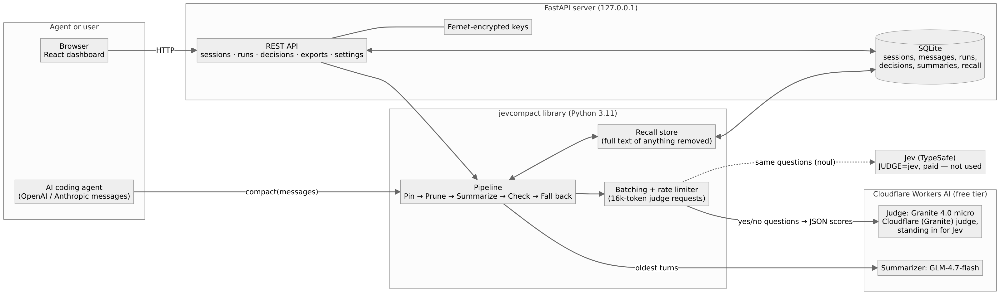
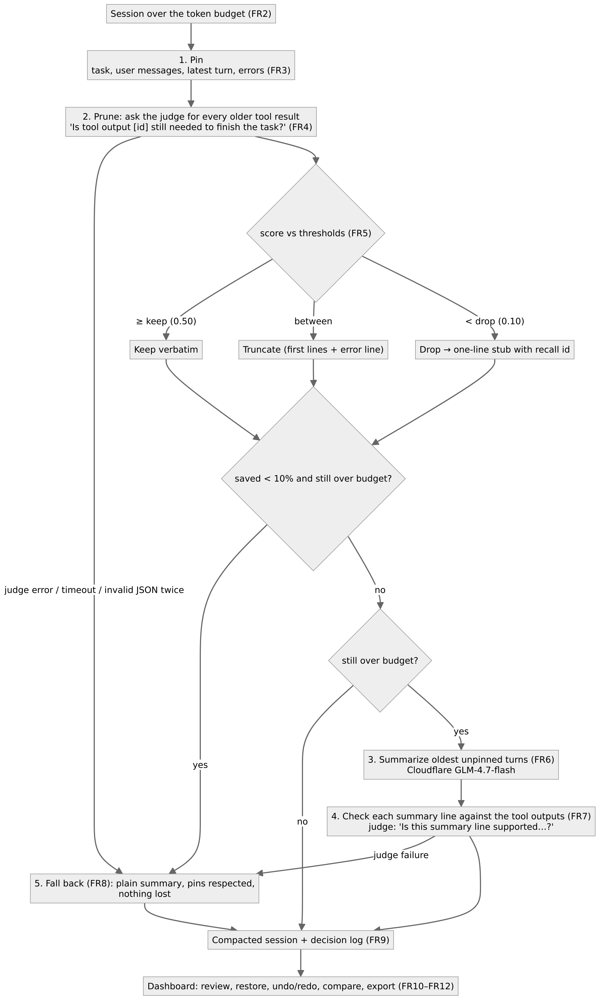
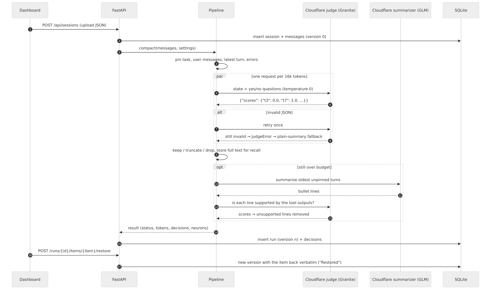
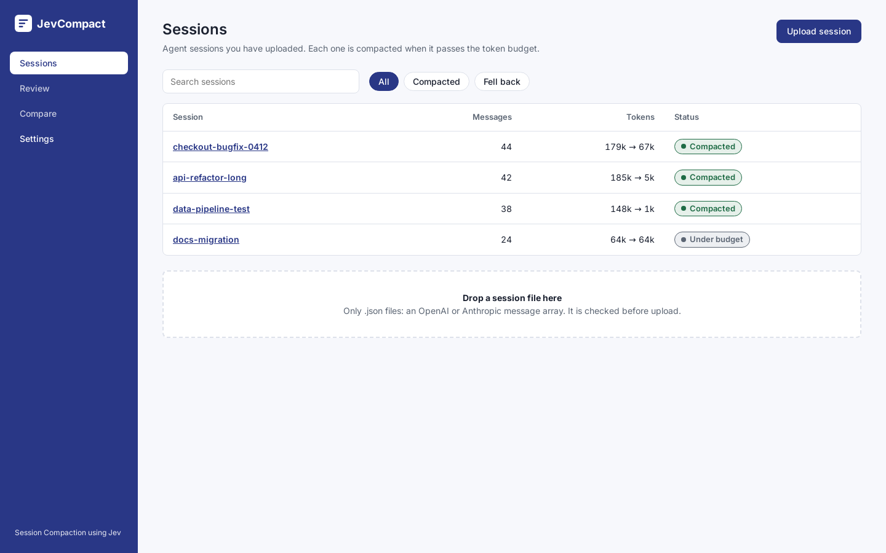
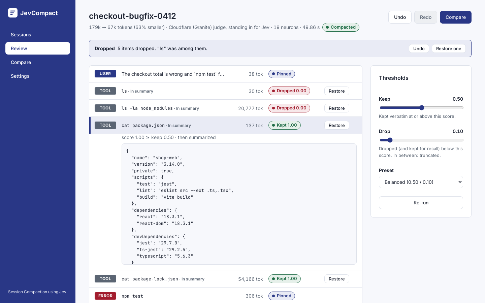
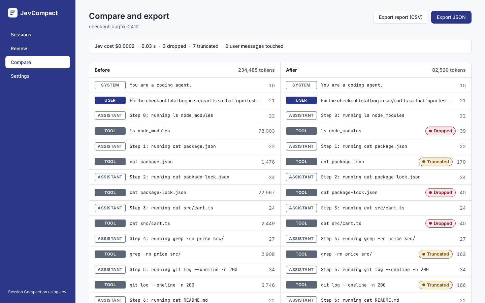
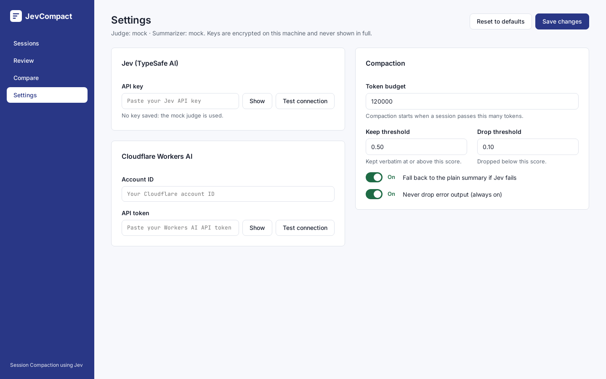

# JevCompact — Session Compaction using Jev

JevCompact shrinks the context of long AI coding-agent sessions before they overflow the model's window.
Instead of cutting the oldest messages (a sliding window) or summarizing everything, it asks a **judge**
one yes/no question per old tool result, *"Is tool output [id] still needed to finish the task?"*, and then
**keeps**, **truncates** or **drops** each one. Only if the session is still over budget does it summarize
the oldest turns, and it then checks every summary line against the tool outputs. Anything removed can be
put back in one click.

> **Judge used in this project: the Cloudflare (Granite) judge, standing in for Jev.**
> Paid Jev (TypeSafe) is not used. The free stand-in is IBM Granite 4.0 micro on Cloudflare Workers AI. It
> is asked Jev's exact yes/no questions and must reply with strict JSON scores from 0 to 1. `JevJudge` is still
> included and works unchanged with `JUDGE=jev` and a Jev key. Why Granite was chosen, and how it differs
> from Jev, is explained in [PROGRESS.md](PROGRESS.md#design-deviations) and
> [docs/measurements/judge_model_bakeoff.json](docs/measurements/judge_model_bakeoff.json).



## Contents
- [How it works](#how-it-works)
- [Setup](#setup-windows-macos-linux-no-gpu)
- [Use it](#use-it): library, CLI, dashboard
- [Configuration](#configuration)
- [Judges](#judges)
- [Evaluation results](#evaluation-results)
- [Tests](#tests)
- [Project layout](#project-layout)
- [Limitations](#limitations)

## How it works



1. **Pin** (FR3): the task, every user message, the latest turn and error outputs are never touched.
2. **Prune** (FR4, FR5): every older tool result is scored by the judge in batched, rate-limited requests.
   - Score ≥ keep threshold (0.50): **kept**.
   - Score below the drop threshold (0.10): **dropped**. A one-line stub with a recall id replaces it, so tool-call pairs stay valid.
   - In between: **truncated** to its first lines plus the error line.
3. **Summarize** (FR6): only if still over budget, the oldest unpinned turns are summarized by Cloudflare
   Workers AI (`@cf/zai-org/glm-4.7-flash`).
4. **Check** (FR7): the judge is asked whether each summary line is supported by the tool outputs. Unsupported
   lines are removed.
5. **Fall back** (FR8): on a judge error, a timeout, invalid JSON twice, or less than 10% savings, the plain
   summary is used instead. Pins are respected, so no user message is lost.

Every decision is logged with its item, score, action and time (FR9). The dashboard shows sessions, scores
and tokens before and after (FR10). Thresholds can be changed and re-run, and any item can be restored, with
undo/redo across versions (FR11). Sessions and savings reports export as JSON or CSV (FR12).



## Setup (Windows, macOS, Linux; no GPU)

Requirements: **Python 3.11**, and Node 18+ for the dashboard.

```bash
# macOS / Linux
sh scripts/setup.sh
# Windows (PowerShell)
powershell -ExecutionPolicy Bypass -File scripts\setup.ps1
```

The scripts create a 3.11 virtual environment with [uv](https://docs.astral.sh/uv/), install the package with its
server and dev extras, build the dashboard, and copy `.env.example` to `.env`. To do the same by hand:

```bash
uv venv --python 3.11 .venv
uv pip install --python .venv/bin/python -e '.[dev]'
cd dashboard && npm ci && npm run build
```

If the uv install script (`curl … | sh`) is blocked on your machine, install uv from PyPI instead:
`pip install --user uv`.

Only Linux has been tested end to end. The code avoids OS-specific paths, and keys fall back from the OS
keyring to an owner-only key file when no keyring is available.

## Use it

**Library**

```python
from jevcompact import CompactionConfig, compact_sync

cfg = CompactionConfig.from_env(budget=120_000)        # JUDGE / SUMMARIZER / keys from the environment
result = compact_sync(messages, cfg)                   # OpenAI or Anthropic message list
result.messages                                        # compacted, same format as the input
result.status, result.tokens_before, result.tokens_after, result.judge_neurons
```

`JevCompactMiddleware` compacts automatically once a live session passes the budget (FR2).

**CLI**

```bash
.venv/bin/jevcompact compact session.json -o compacted.json --judge cloudflare --summarizer cloudflare \
    --report report.json --csv report.csv
```

**Dashboard**

```bash
.venv/bin/jevcompact serve            # http://127.0.0.1:8000 (binds to localhost only)
```

| Sessions | Review | Compare and export | Settings |
|---|---|---|---|
|  |  |  |  |

Keyboard shortcuts on the Review screen: **J/K** move, **R** restores, **U** undoes. All eight screenshots are in
[docs/screenshots/](docs/screenshots/).

## Configuration

`.env` (see [.env.example](.env.example)). Keys can also be saved in Settings, where they are encrypted at rest
with Fernet and masked everywhere.

| Variable | Meaning |
|---|---|
| `JUDGE` | `jev`, `cloudflare` or `mock`. If unset, the server uses Jev when a Jev key is saved, else Cloudflare when Cloudflare keys are saved, else mock. The evaluation uses `cloudflare` unless `JUDGE=jev`. |
| `SUMMARIZER` | `cloudflare` or `mock` |
| `CF_ACCOUNT_ID`, `CF_API_TOKEN` | Cloudflare Workers AI. One account and token serve both the judge and the summarizer. |
| `CF_JUDGE_MODEL` | judge model, default `@cf/ibm-granite/granite-4.0-h-micro` |
| `CF_MODEL` | summarizer model, default `@cf/zai-org/glm-4.7-flash` |
| `JEV_API_KEY`, `JEV_BASE_URL`, `JEV_MODEL` | Jev, direct or via OpenRouter (`https://openrouter.ai/api/v1`, `~typesafe/jev-latest`) |

Thresholds use presets (conservative 0.30/0.05, balanced 0.50/0.10, aggressive 0.70/0.20) or custom values.
The keep threshold must be higher than the drop threshold.

**Provider limits.** The Jev limits used as defaults come from our SRS (TypeSafe's models page, Oct 2026), not from
the quickstart: 32k tokens per request, 80 requests/s, 100k tokens/s, English only, $0.042 per million input
tokens. The Cloudflare judge uses smaller 16k-token requests and a longer timeout. All are configurable in
`CompactionConfig`.

**Cloudflare free tier: 10,000 neurons a day.**
- Judge (Granite 4.0 micro): 1,542 neurons per million input tokens and 10,158 per million output tokens. Scoring a typical 180k-token session costs about 6–10 neurons.
- Summarizer (GLM-4.7-flash): 5,500 / 36,400 neurons per million input / output tokens. A summary costs about 65 neurons at 5k tokens in, ~165 at 20k, and ~470–770 for the 70k–120k-token summaries in the evaluation.
- Summaries are cached by content hash.

## Judges

| Judge | Use | Cost | Notes |
|---|---|---|---|
| **Cloudflare (Granite) judge, standing in for Jev** | `JUDGE=cloudflare` | neurons (free tier) | Strict JSON `{"scores": {...}}` at temperature 0. Invalid JSON is retried once, then treated as a judge failure (fallback). Scores are not calibrated like Jev's; in practice they are almost always exactly 0 or 1. |
| Jev (TypeSafe) | `JUDGE=jev` | $0.042 / M input tokens | `noul` questions, calibrated probabilities. Not used in this project's results. |
| MockJudge | `JUDGE=mock` | free | Deterministic rules, for tests and the secondary (mock) evaluation. |

To try GLM as the judge, set `CF_JUDGE_MODEL=@cf/zai-org/glm-4.7-flash`. Every label then reads "Cloudflare (GLM) judge, standing in for Jev".

## Evaluation results

Full tables: [eval/results.md](eval/results.md). Charts: [docs/figures/](docs/figures/). Report summary:
[docs/report_assets/SUMMARY.md](docs/report_assets/SUMMARY.md).

<!-- RESULTS:START -->
(filled in from eval/results.md)
<!-- RESULTS:END -->

## Tests

```bash
.venv/bin/python -m pytest -m "not live"      # library, server, eval code (mocked HTTP; no keys needed)
.venv/bin/python -m pytest -m live            # real Cloudflare (and Jev if JEV_API_KEY is set)
cd dashboard && npm run test:e2e               # 21 Playwright UI tests
SHOTS_REAL=1 npm run screenshots               # docs/screenshots/01–08 with the real Cloudflare providers
```

Measurements are in [docs/measurements/](docs/measurements/). Each file says whether it is `mock` or `real`.

## Project layout

```
jevcompact/        library: pipeline, pinning, prune, summarize, check, judges/, summarizers/
server/            FastAPI app, SQLite schema (server/db/schema.sql), run manager, encrypted settings
dashboard/         React + Vite UI, Playwright tests (e2e/)
data/samples/      six sample sessions + hand labels (eval/LABELS.md)
eval/              run_eval.py (four methods, clipping, threshold sweep), report.py, results
scripts/           setup, judge bake-off, DB snapshots, ER diagram generator
docs/              diagrams, screenshots, figures, measurements, report_assets
```

Database schema: [docs/diagrams/er.png](docs/diagrams/er.png). It is generated from `server/db/schema.sql` by `scripts/gen_er.py`.

## Limitations
- The results come from a stand-in judge, not Jev. Granite's near-binary scores give low recall of needed items on
  the real samples, so prune-only and the hybrid keep fewer needed items than the baselines (see results).
- The 1 s scoring-latency target was set for Jev. The Cloudflare judge takes about 15 s for 32k tokens of candidates.
- Only six sample sessions, labelled by us. Thresholds tuned on them are checked with leave-one-session-out, but
  the evidence is still small.
- Tested on Linux only.
